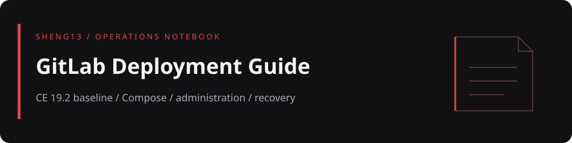

# GitLab CE 19.2 本機部署與管理指南

以 Ubuntu 24.04 與 Docker Compose 為實測基線的中文教學，從第一次登入、專案與權限管理，延伸到 Runner、CI/CD、升級、備份與恢復演練。這個儲存庫保存教程、部署範例、圖片與 PDF 產生程式，不包含正式服務資料。

> 文件基準為 **2026-08-10、GitLab CE `19.2.1-ce.0`**。以下歷史結果來自原始文件，不是本次重新部署或測試；也不代表這個版本是目前最新版。

[閱讀入口](#reading) · [部署範例](#deployment) · [產生 PDF](#pdf) · [歷史驗證紀錄](#baseline) · [檔案地圖](#map) · [操作安全](#safety)

<a id="reading"></a>
## 閱讀入口

| 需求 | 檔案與內容 |
|---|---|
| 第一次接觸 GitLab | [完整圖文教程](gitlab_deployment_guide.md)：名詞、登入、練習專案、Issue、Merge Request 與 Git 操作 |
| 維護自架服務 | 同一教程內的 Docker／原生套件部署、Admin Area、Runner、備份、升級與故障排查 |
| 離線閱讀 | [GitLab_Local_Deployment_Guide.pdf](GitLab_Local_Deployment_Guide.pdf) |
| 檢視容器範例 | [examples/docker-compose.yml](examples/docker-compose.yml) |
| 查看既有圖片 | [原封面](images/gitlab-self-hosted-cover.png)、[架構圖](gitlab_architecture.jpg)、[Docker 流程圖](gitlab_docker_flow.jpg)、[CI/CD 流程圖](gitlab_cicd_pipeline.jpg) |

只想閱讀不需要安裝 Node.js，也不需要啟動 GitLab。修改教程時，以 Markdown 原稿為主，再另行產生 PDF；不要假設兩份內容會自動同步。

<a id="deployment"></a>
## 部署範例的實際設定

根目錄沒有一鍵安裝腳本。請先閱讀完整教程，再審核範例的主機名稱、掛載目錄與對外位址；不要直接在既有服務目錄執行。

| 範例項目 | 設定 |
|---|---|
| 鏡像 | `gitlab/gitlab-ce:19.2.1-ce.0` |
| 容器名稱 | `gitlab` |
| Web | 宿主機 `8080` → 容器 `80` |
| Git SSH | 宿主機 `8022` → 容器 `22` |
| 持久資料 | `config` → `/etc/gitlab`、`logs` → `/var/log/gitlab`、`data` → `/var/opt/gitlab` |
| 其他 | `restart: always`、`shm_size: "256m"` |

範例保留作者原環境的 hostname 與絕對掛載路徑，不是任意主機都適用的設定。教程也有 `/srv/gitlab` 的另一組示例，應以自己選定的 Compose 檔為準，不能混用兩組備份與資料路徑。

`8080:80` 與 `8022:22` 沒有限定宿主機回環位址；啟動前先決定允許誰存取，並確認 `external_url`、SSH 對外連接埠、反向代理與防火牆一致。正式環境應選經過驗證的固定版本，避免直接改為 `latest`。

<a id="pdf"></a>
## 產生 PDF

需要 Node.js／npm，以及已安裝、可執行的 Chrome 或 Chromium。`package.json` 固定使用 `marked` `16.1.1` 與 `puppeteer-core` `24.16.0`；`puppeteer-core` 不會替這個專案自動下載瀏覽器。

保留原始建置步驟，在儲存庫目錄執行：

```bash
npm install
npm run pdf
```

`generate_pdf.js` 讀取 `gitlab_deployment_guide.md`，內嵌相對圖片，並覆寫 `GitLab_Local_Deployment_Guide.pdf`。預設瀏覽器路徑是 `/usr/bin/google-chrome`，不是自動搜尋；若瀏覽器在其他位置，請用 `CHROME_PATH` 指定實際可執行檔。

```bash
CHROME_PATH=/path/to/chromium npm run pdf
```

`/path/to/chromium` 是佔位路徑，請換成自己的安裝位置。腳本帶有 `--no-sandbox` 與 `--disable-setuid-sandbox`，只處理自己信任的 Markdown 與圖片，不要讓它替不受信任的檔案產生 PDF。

`npm test` 與 `npm run pdf` 都只是執行 `node generate_pdf.js`，不代表有獨立的測試套件或 CI 驗證。本次文件更新未執行套件安裝、PDF 建置或 GitLab 服務測試。

<a id="baseline"></a>
## 原文件的歷史驗證紀錄

下表保留原 README 在 **2026-08-10** 記錄的結果，省略環境專屬的網路位址。它們是歷史紀錄，不是目前服務健康狀態。

| 項目 | 原文件記錄 |
|---|---|
| 環境 | Ubuntu 24.04 + Docker Compose |
| Web | `8080`，HTTP 200 |
| Git SSH | `8022` |
| 鏡像 | `gitlab/gitlab-ce:19.2.1-ce.0` |
| 容器 | `healthy`，核心服務運行 |
| 備份 | 應用備份、設定與密鑰分開保存並校驗 |

要確認自己的部署，請依教程重新檢查服務、權限、備份與恢復；HTTP 200 本身不能證明 CI/CD、SSH 或災難恢復可用。

<a id="map"></a>
## 檔案地圖

```text
.
├── README.md
├── gitlab_deployment_guide.md            完整教學原稿
├── GitLab_Local_Deployment_Guide.pdf     既有離線版
├── examples/docker-compose.yml          部署範例
├── generate_pdf.js                      Markdown → PDF
├── package.json / package-lock.json     PDF 建置命令與相依套件
├── gitlab_*.jpg                         架構與流程圖
├── images/                             既有封面與登入畫面
└── docs/readme-banner.svg               首頁設計橫幅，非服務截圖
```

<a id="safety"></a>
## 操作安全

- 教材與正式資料分開保存。不要上傳 `gitlab-secrets.json`、SSH 主機私鑰、真實密碼、Token、設定備份或應用備份包。
- 升級前確認支援的升級路徑、可用磁碟、備份與回復方法；恢復必須核對備份對應的 GitLab 版本與版本類型，不要直接覆蓋正式資料。
- 應用備份不等於設定與密鑰備份；兩者要一起保護，並另存異機或加密儲存。保有備份檔不等於演練恢復成功。
- Runner 會執行專案中的工作，註冊權杖與 Docker socket／privileged 權限必須另外審核，不要把不受信任專案接到高權限 Runner。
- 公開日誌、截圖與 Issue 前移除帳號、私有位址、權杖和專案內容。頁首橫幅與流程圖不是服務或 CI 通過的證據。
